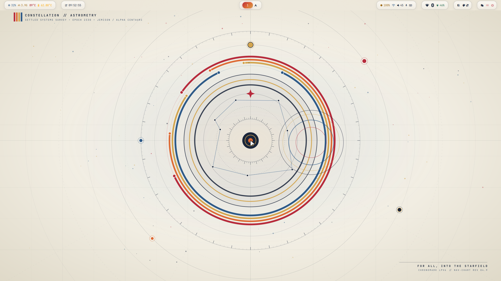
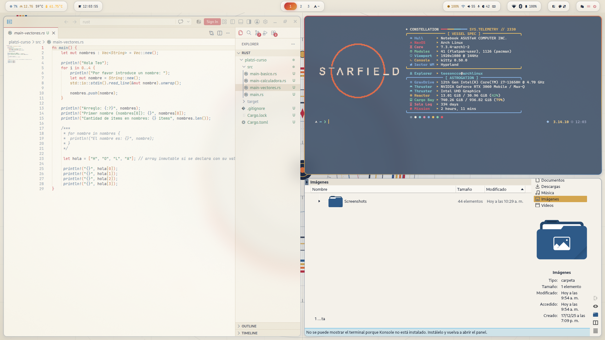
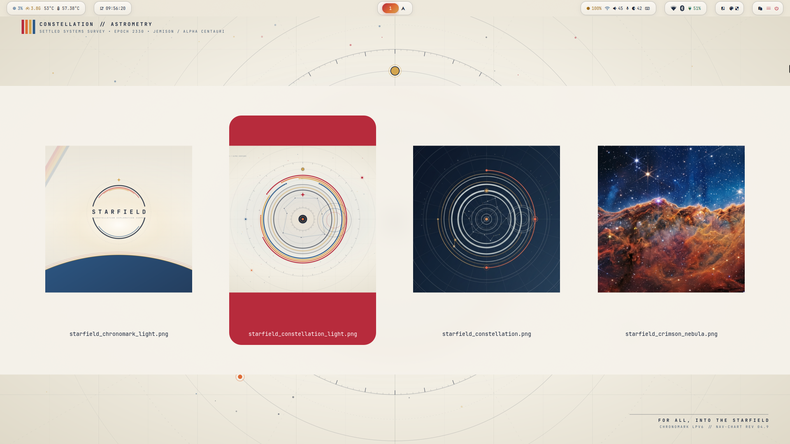
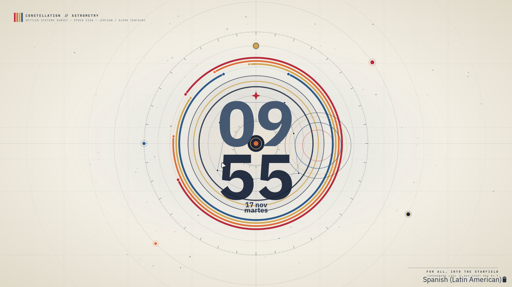

# Starfield — Tema NASA-Punk Light Mode para HyDE

> Tema híbrido (**escritorio Light Mode** en Alabastro Lunar `#F4F1EA` + **consola Chronomark Slate** `#3E5068`) inspirado en la estética *Constellation / Chronomark* de **Starfield**, diseñado para **HyDE** (Hyprland), **VS Code**, **Kitty** y **Fastfetch**.



> [!IMPORTANT]
> **Requisito indispensable:** Este tema requiere tener instalado **[HyDE](https://github.com/HyDE-Project/HyDE)** (`hydectl` y su sistema de temas/Wallbash). No funcionará de forma independiente en una instalación estándar de Hyprland sin HyDE.

---

## Capturas

### Escritorio, VS Code, Kitty y Gestor de Archivos


### Selector de Wallpapers (Rofi)


### Pantalla de Bloqueo (Hyprlock)


---

## Instalación rápida

```bash
git clone https://github.com/teosoncco/hyde-theme-starfield.git
cd hyde-theme-starfield
chmod +x install.sh
./install.sh --apply
```

También puedes instalarlo sin aplicarlo de inmediato con `./install.sh` y luego activarlo en cualquier momento desde el selector visual de HyDE (`hydectl theme select`) o ejecutando:

```bash
hydectl theme set Starfield
```

- **Fastfetch:** Para probar el layout de Starfield sin sobrescribir tu configuración global de HyDE, ejecuta `fastfetch --config starfield.jsonc`.
- **VS Code / Code - OSS:** Si aún no tienes instalada la extensión `Wallbash` de HyDE en VS Code, ejecuta `~/.config/hyde/wallbash/scripts/code.sh` una única vez; a partir de ahí, VS Code adoptará la paleta de Starfield solo mientras el tema esté activo.

---

## Licencia y Créditos

Copyright (C) 2026 **teosoncco**.

- Las configuraciones, scripts, adaptaciones y diseño del tema en este repositorio se distribuyen bajo la licencia **GNU General Public License v3.0 (`GPL-3.0`)**. Consulta el archivo [LICENSE](LICENSE) para más detalles. Si creas un trabajo derivado o redistribuyes este proyecto, debes mantener el crédito al autor original y conservar la licencia GPL-3.0.
- `Starfield-Icons` hereda y adapta íconos de `Tela-circle-blue` (GPL-3.0), y los archivos de `kvantum` están adaptados sobre la base de `Catppuccin Latte`.
- Los nombres, logotipos y artes oficiales de *Starfield* así como los fondos descargados de WallpaperCave pertenecen a sus respectivos autores y a **Bethesda Softworks / ZeniMax Media** (proyecto fan-made sin fines comerciales).
